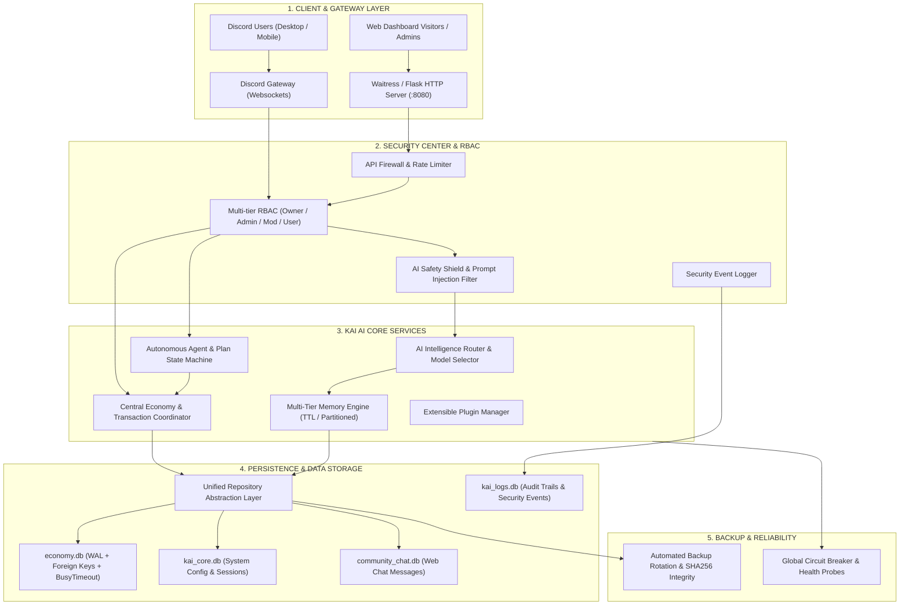
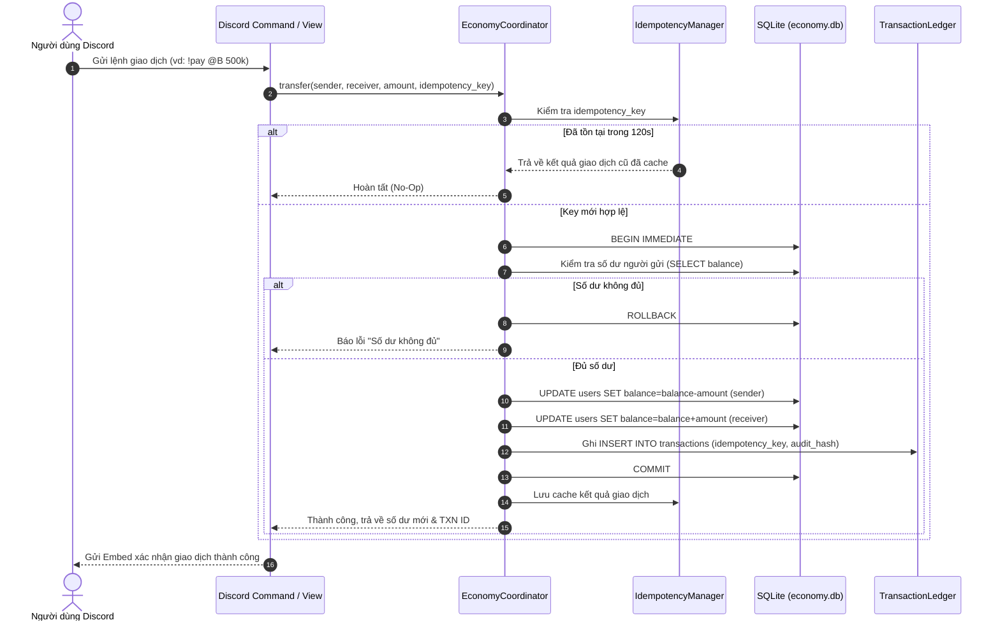

# ARCHITECTURE PLAN — KAI AI ULTIMATE V7
## BẢN THIẾT KẾ KIẾN TRÚC HỆ THỐNG KAI AI V7

**Mục tiêu thiết kế:** Xây dựng hệ sinh thái Discord Bot AI & Game Kinh tế đẳng cấp Enterprise, vận hành bền bỉ 24/7, an toàn tuyệt đối trước các cuộc tấn công và dễ dàng mở rộng.

---

### 1. SƠ ĐỒ TỔNG THỂ KIẾN TRÚC HỆ THỐNG (SYSTEM TOPOLOGY)

---

### 2. CÁC PHÂN HỆ CỐT LÕI V7 (CORE ARCHITECTURAL SUBSYSTEMS)

#### 2.1. Security Center & Multi-Tier RBAC
- **Phân quyền 4 cấp:**
  1. `Owner`: Toàn quyền cấu hình bot, shutdown, reload cog, backup/restore, truy cập console. Được kiểm tra qua `BOT_OWNER_ID` cấu hình ở biến môi trường.
  2. `Administrator`: Quyền quản trị server Discord (`guild_permissions.administrator`), quản lý cấu hình bot trong server, xem logs server.
  3. `Moderator`: Quyền ban/kick/mute, xử lý vi phạm kinh tế trong server theo vai trò staff.
  4. `Member / Guest`: Sử dụng các lệnh người dùng thông thường và dashboard chế độ chỉ đọc.
- **Server-Side Least Privilege:** Mọi dữ liệu quyền từ interaction hoặc claim từ client đều bị bỏ qua; trạng thái quyền luôn được tính toán trực tiếp từ Discord API hoặc Backend session trên server.
- **Bảo mật Web & API:**
  - Token-based CSRF protection cho toàn bộ request POST/PUT/DELETE.
  - Multi-tier Rate Limiting: 60 req/phút theo IP, 5 req/15s theo session cho chat, giới hạn toàn cục chống DoS.
  - Chèn toàn diện các HTTP Security Headers (`CSP`, `X-Frame-Options`, `X-Content-Type-Options`, `HSTS`).

---

#### 2.2. Central Economy Engine & Transaction Coordinator
- **Nguyên tắc "Single Source of Truth":**
  - Mọi thao tác tài chính (Wallet, Bank, Pay, Loan, Interest, Company, Stock, Betting) đều phải đi qua **`EconomyCoordinator`** chung của tiến trình.
  - Giải quyết dứt điểm BUG-01: Thay thế các lock rời rạc bằng một `Shared Process Lock` duy nhất kèm `sqlite3` busy timeout 15.000ms và chế độ `BEGIN IMMEDIATE`.
- **Luồng giao dịch an toàn (Atomic Transaction Flow):**

---

#### 2.3. AI Intelligence Core V7
- **AI Router & Model Selection Engine:**
  - **Dynamic Complexity Classifier:** Phân tích prompt của người dùng để xác định độ phức tạp:
    - *Đơn giản (Hỏi đáp nhanh, chào hỏi, meme):* Định tuyến tới mô hình nhẹ, tốc độ cao (`gpt-4o-mini` hoặc `gemini-flash-lite`).
    - *Phức tạp (Lập kế hoạch đa bước, phân tích tài chính, reasoning):* Định tuyến tới mô hình cao cấp (`gpt-4o` hoặc `gemini-pro`).
  - **Fallback Chain & Auto Recovery:**
    `Primary Provider` → Lỗi tạm thời (429, 500, 503) → Retry backoff có jitter → `Secondary Provider` → Circuit Breaker ghi nhận lỗi.
- **Advanced Memory Hierarchy (Bộ nhớ đa tầng):**
  1. *Short-Term Session Memory:* Lưu 10 lượt hội thoại gần nhất trong phiên, tự động expire sau 30 phút không hoạt động.
  2. *Long-Term Fact Store:* Trích xuất các sự thật then chốt (sở thích, biệt danh, thông tin người dùng chia sẻ) có phân vùng rõ ràng theo `(user_id, guild_id)`.
  3. *Server Memory:* Lưu ngữ cảnh và văn hóa của server riêng biệt, tuyệt đối không rò rỉ sang server khác.
  4. *Privacy & GDPR Purge:* Người dùng có quyền xem (`!aimemory`) và xóa vĩnh viễn (`!aimemory clear`) dữ liệu cá nhân của mình.
- **Safety Guard & Anti-Hallucination:**
  - Trước khi gọi LLM: Kiểm tra Prompt Injection / Jailbreak.
  - Sau khi nhận phản hồi: Output Validator rà soát xem AI có tự bịa đặt số dư tài khoản hay không. Nếu có nhắc đến tiền bạc, bắt buộc phải khớp với dữ liệu thực tế được truyền trong context.

---

#### 2.4. Autonomous AI Agent (Quy trình Kế hoạch Bền vững)
- **Quy trình 10 bước:**
  `Yêu cầu người dùng` → `Intent Detection` → `Plan Generation` → `Permission Validation` → `Risk Assessment` → `User Confirmation` → `Execution` → `Result Validation` → `Audit Logging` → `Final Report`.
- **Lưu trữ Kế hoạch Bền vững (Persistent Plan Store):**
  - Chuyển toàn bộ kế hoạch từ RAM sang lưu trữ trong database (`ai_plans` table).
  - Trạng thái kế hoạch: `DRAFT` → `PENDING_CONFIRMATION` → `APPROVED` → `EXECUTING` → `STEP_SUCCESS` → `COMPLETED` (hoặc `FAILED` / `ROLLED_BACK`).
  - Khởi động lại bot không làm mất kế hoạch đang thực hiện; kế hoạch bị dở dang sẽ được phục hồi an toàn.

---

#### 2.5. Unified Database Engine & Repository Pattern
- **Repository Abstraction:**
  Tách riêng logic truy vấn cơ sở dữ liệu ra khỏi các Discord Cogs. Cung cấp các Interface chuẩn:
  - `IUserRepository`: Đọc/ghi thông tin người dùng, số dư ví, tài khoản ngân hàng.
  - `ITransactionRepository`: Ghi sổ cái giao dịch tài chính, truy vấn lịch sử và thống kê.
  - `ICompanyRepository`: Quản lý danh sách công ty, cổ đông, thị trường chứng khoán.
  - `IMemoryRepository`: Lưu trữ bộ nhớ hội thoại và facts.
  - `IPlanRepository`: Quản lý kế hoạch đa bước của AI Agent.
- **Lợi ích:** Các Cog chỉ tương tác qua Repository. Trong tương lai khi cần chuyển từ SQLite sang PostgreSQL khi số lượng người dùng vượt quá 100.000, chỉ cần viết lại implementation của Repository mà không phải sửa đổi bất kỳ dòng code nào trong Discord Cogs!
- **Versioned Migration Engine:**
  - Áp dụng migration có version tracking (`schema_migrations` table) cho tất cả các database.
  - Mỗi migration gồm 2 hàm: `up(db)` và `down(db)` hỗ trợ rollback an toàn.

---

#### 2.6. Plugin Architecture V7
- **Plugin Registry & Manifest:**
  Mỗi module mở rộng có thể đăng ký dưới dạng Plugin có Manifest:
  - `id`: Định danh duy nhất (vd: `vn_stock_market`).
  - `version`: Phiên bản tương thích (vd: `7.0.0`).
  - `permissions`: Khai báo các quyền yêu cầu (vd: `read_economy`, `write_economy`, `ai_tool`).
  - `dependencies`: Các plugin hoặc module phụ thuộc.
- **Error Isolation (Cô lập sự cố):**
  Lỗi phát sinh trong một plugin bên thứ ba được cô lập hoàn toàn; không làm crash bot hay ảnh hưởng tới các phân hệ cốt lõi.

---

### 3. KẾ HOẠCH BẢO ĐẢM TÍNH TƯƠNG THÍCH VÀ ROLLBACK
- Mọi bảng cơ sở dữ liệu hiện có (`users`, `transactions`, `companies`, `shares`, `market`, `ai_sessions`) đều được giữ nguyên cấu trúc cũ và chỉ mở rộng thêm các cột mới với giá trị mặc định (`DEFAULT`).
- Bản sao lưu tự động (Backup Snapshot) được kích hoạt trước khi chạy bất kỳ bước migration nào.
- Giữ nguyên toàn bộ cú pháp của các lệnh prefix hiện có (`!pay`, `!dep`, `!with`, `!market`, `!taisan`, `!topmoney`, `!kehoach`, `!xacnhan`, `!vaytien`, `!thechap`...) để người dùng không gặp bất kỳ gián đoạn nào.

